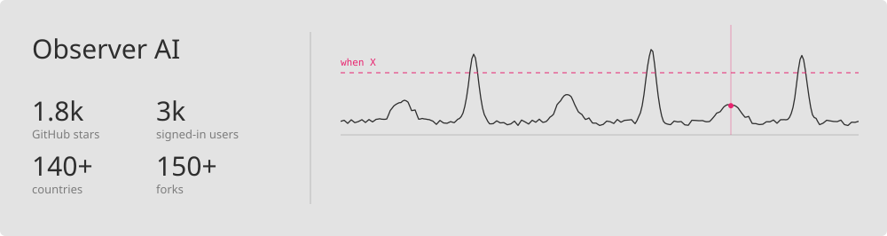

**AI Engineer that ships to real users.** 2026 #SanFranciscoTechWeek by a16z panelist, ex-physics researcher.

  

Founding AI Engineer at [**Observer AI**](https://github.com/Roy3838/Observer): an **open-source orchestrator**, for **micro-agents**, that monitors anything using **local** models and acts when something happens.

<picture><source media="(prefers-color-scheme: dark)" srcset="assets/h-tech-stack-dark.svg"></picture>

| | |
| :-- | :-- |
| **Languages** | Python, TypeScript, Rust, Julia, Swift, Kotlin, C |
| **AI** | MCP, RAG, PyTorch, Agent Evals, OpenAI API, Multi-Agent Systems |
| **Computer Vision** | Decision Models, MultiModality, Transformers.js, ONNX, llama.cpp |
| **MLOps & Infra** | GitHub Actions, Docker, Playwright, MLflow, FastAPI, Redis, AWS (Bedrock, EC2), Cloudflare (Pages, Workers, AI) |
| **Spoken Languages** | Spanish (native), English (fluent), German (B1) |

- **Observer**: **open-source micro-agent framework**, driven by an **orchestrator**, that monitors anything using **local** models and acts when something happens. 3k+ signups in 140+ countries, 1.8k+ stars, top 35 of 11,000+ local-llm repos.
- **MCP orchestrator:** agent that turns one request into running agents via an agentic tool-calling loop over 22 JSON-Schema tools (manage agents, capture and crop screen or camera, load models).
- **E2E Eval Harness:** black-box Playwright suite: an orchestrator agent builds a monitor from one prompt, scored for missed triggers and false positives over repeated runs for pass rates.
- **Neurosymbolic agent builder:** LLM classifies each request into a typed ontology (target, trigger shape, cardinality); a rule engine validates generated agents against it and feeds violations back for self-repair.
- **On-device inference engine** (Rust): llama.cpp with Metal acceleration, multimodal GGUF models with vision projectors and tunable visual-token budgets; in-browser ONNX inference via Transformers.js.
- **Decision models:** shipped OneJev vision classifiers two weeks after release, reading answer probabilities from token logits; ported the training prompt renderer byte-for-byte and checked logit parity against PyTorch.
- **CI/CD:** GitHub Actions matrix that builds, code-signs and releases the desktop app for macOS (ARM, Intel), Windows and Linux, with a bundled Rust CLI and signed auto-updates.
- **Production Backend** (Python, FastAPI): LLM/DM gateway with load-tested Redis quotas, Auth, Stripe/App Store billing, enterprise orgs, and WhatsApp/Telegram/SMS/voice; Docker behind Cloudflare.
- **Upstream contributor** to llama-cpp-rs: merged image-token parameters for Gemma4-type models.

**Physics Undergraduate Researcher** · División de Información Cuántica, UNAM · Mexico `2024 – 2025`

- Entanglement in Bose-Fermi mixtures in optical lattices. Built the Julia simulation codebase: sparse Hamiltonians, Krylov exact diagonalization, multithreading. Paper in preparation.

**Freelance Engineer** `2023`

- Server deployments (FreeBSD invoicing server for Ignix), penetration testing.

<picture><source media="(prefers-color-scheme: dark)" srcset="assets/h-research-dark.svg"></picture>

- **Bose-Fermi mixtures**: entanglement in optical lattices, simulated in Julia; paper in preparation ([code](https://github.com/Roy3838/Bose-Fermi))
- **Hyper-Kamiokande**: PMT characterization
- **Photon triplets**: entangled photon triplets via third-order SPDC

<picture><source media="(prefers-color-scheme: dark)" srcset="assets/h-selected-projects-dark.svg"></picture>

| | |
| :-- | :-- |
| [**LlamaTube**](https://github.com/Roy3838/LlamaTube) | LoRA fine-tuning of Llama 3.1 for text classification on 8-bit quantized weights (PyTorch, PEFT, W&B) |
| [**TitleTransformers**](https://github.com/Roy3838/TitleTransformers) | Attention-based model predicting YouTube engagement from titles (PyTorch) |
| [**manimations**](https://github.com/Roy3838/manimations) | Physics animations in Manim |

<picture><source media="(prefers-color-scheme: dark)" srcset="assets/h-education-dark.svg"></picture>

**B.S. in Engineering Physics** (Ingeniero Físico Industrial), Instituto Tecnológico de Monterrey `2019 – 2024` 
Minor in **Photonics and Quantum Technology** `2023`

 

  <a href="mailto:roymedina@me.com"><code>roymedina@me.com</code></a> ·
  <a href="https://app.observer-ai.com"><code>app.observer-ai.com</code></a> ·
  <a href="https://discord.com/invite/wnBb7ZQDUC"><code>discord</code></a>

